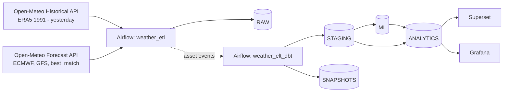

# Weather Prediction Analytics

DATA 226 Lab 1. We pull daily weather for **San Francisco** and **New York** from the Open-Meteo API, load it into
Snowflake with Airflow, transform it with dbt, and show the results in Superset (plus a small Grafana dashboard
for pipeline monitoring).

Stack: Open-Meteo -> Airflow 3.3 (ETL) -> Snowflake -> dbt (ELT + Snowflake ML) -> Superset / Grafana

## Architecture



- **ETL (`dags/weather_etl.py`)**: runs daily. For each city it calls the APIs, flattens the JSON into rows and
  MERGEs them into the RAW tables inside a transaction (BEGIN / COMMIT, ROLLBACK + raise on error), so rerunning is safe.
- **ELT (`dags/weather_elt_dbt.py`)**: runs the dbt project with Astronomer Cosmos. It's scheduled on the RAW tables
  (Airflow assets), so it starts right after the ETL finishes. It runs each model, then that model's tests, then the snapshot.
- **dbt (`dbt/`)**: staging views, intermediate models, a Snowflake ML forecast, and the marts used by the dashboards.
- **Snowflake setup (`infra/`)**: warehouses, database, schemas, roles, service users and grants are created with Terraform.

## Metrics and forecasts

Metrics in `fct_weather_daily`: 7 and 30-day moving averages, temperature anomaly vs the 1991-2020 normal,
7 and 30-day rolling rainfall, and dry spell length.

We compared 7-day forecasts of the daily high (MAE in °C, averaged over 1-7 days ahead):

| Method | San Francisco | New York |
|---|---|---|
| Snowflake ML.FORECAST | **2.07** | **2.39** |
| 7-day moving average | 2.62 | 4.41 |
| Persistence (tomorrow = today) | 2.85 | 4.69 |
| Climatology (1991-2020 normal) | 2.90 | 3.91 |

The ECMWF and GFS forecasts are saved every day and get scored once enough of them can be checked against actual weather.

## Running it

You need Docker, Terraform, Python 3.11 and a Snowflake account.

```bash
make venv                 # local Python env (dbt, ruff, pytest)
make keys env             # key pairs for the Snowflake service users + .env (both gitignored)
make bootstrap-sql        # one-time SQL for the Terraform user, run it in Snowsight as ACCOUNTADMIN
# copy infra/snowflake/terraform/terraform.tfvars.example to terraform.tfvars and fill it in
make tf-init tf-plan tf-apply
make up                   # Airflow :8080, Superset :8088, Grafana :3000
make airflow c="dags trigger weather_etl"
```

Other useful targets: `make check` (lint + tests), `make test-dags`, `make dbt-build`, `make help`.

## Folders

```
dags/        Airflow DAGs (dags/common has the API client and the Snowflake loader)
dbt/         dbt project (models, tests, snapshot, seed, macros)
infra/       Snowflake bootstrap SQL, Terraform, and policy checks for the Terraform plan
docker/      docker-compose, Airflow image, Superset and Grafana setup
config/      Airflow connections and variables (loaded at startup)
data/        dataset notes and small sample CSVs
scripts/     helper scripts (keys, .env, bootstrap SQL)
tests/       unit tests and DAG tests
```

## Notes

- Credentials are never in the code. Airflow uses the connections `snowflake_etl` and `snowflake_dbt`
  (key-pair auth); the private keys and passwords live in a local `.env` / `secrets/` that are gitignored.
- Each tool has its own Snowflake user and role (ETL loads RAW, dbt builds the rest, BI is read-only).
- Weather data from [Open-Meteo.com](https://open-meteo.com/) (CC-BY 4.0).
